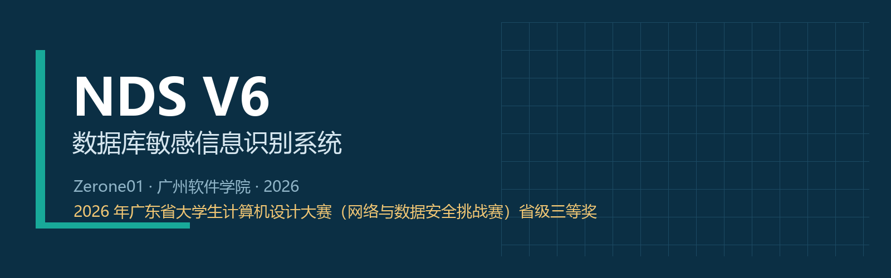
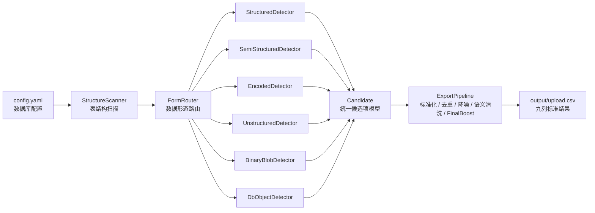

<div align="center">
  
</div>

<h1 align="center">NDS V6 · 数据库敏感信息识别系统</h1>

<p align="center">
  
  
  
  
  
</p>

> **2026 年广东省大学生计算机设计大赛（网络与数据安全挑战赛）省级三等奖**
>
> 参赛队伍：广州软件学院 · **Zerone01** ｜ 作品编号：**20265412010** ｜ 参赛成员：Zerone01 团队（姓名已脱敏） ｜ 指导教师：已脱敏
>
> **下载**：[Releases v6.0.0](https://github.com/zpis666/NDS/releases/tag/v6.0.0) · [Windows 可执行程序](release/NDS_V6.exe) · [正式提交结果](results/upload.csv)

---

## 项目简介

NDS V6（Network Data Scanner V6）是一套面向数据库敏感信息发现任务的本地化识别系统。系统连接 **MySQL** 与 **PostgreSQL** 数据库，扫描表字段、半结构化内容、编码文本、自然语言文本、图片 BLOB 以及数据库对象定义，自动识别并分类敏感信息，最终输出符合赛事规范的 `upload.csv`。

在 2026 年广东省大学生计算机设计大赛（网络与数据安全挑战赛）中，NDS V6 完成正式提交与现场答辩，**平台实测得分 92.78%，实际运行时间约 18 分钟，覆盖 6 类数据形态**，最终荣获**省级三等奖**。

## 获奖信息

| 项目 | 内容 |
| --- | --- |
| 赛事 | 2026 年广东省大学生计算机设计大赛（网络与数据安全挑战赛） |
| 奖项 | **省级三等奖（省三）** |
| 参赛学校 | 广州软件学院 |
| 队伍名称 | Zerone01 |
| 作品编号 | 20265412010 |
| 参赛成员 | Zerone01 团队（姓名已脱敏） |
| 指导教师 | 已脱敏 |
| 决赛时间 | 2026 年 6 月 27 日 |
| 平台实测得分 | **92.78%** |
| 实际运行时间 | 约 **18 分钟** |

## 核心特性

### 六类数据形态，自动路由

系统先读取数据库表结构，再由 `FormRouter` 按字段类型与字段名语义将每一列分流到对应的检测器，无需人工标注：

| 数据形态 | 检测模块 | 处理重点 |
| --- | --- | --- |
| `structured` | `detectors/structured.py` | 普通字段中的姓名、手机号、身份证、银行卡、地址等 |
| `semi_structured` | `detectors/semi_structured.py` | 递归解析 JSON/JSONB，通过键名与值共同判断敏感类型 |
| `encoded` | `detectors/encoded.py` | Base64、Hex、URL 多层解码后执行 JSON/KV 解析与规则匹配 |
| `unstructured_text` | `detectors/unstructured.py` | 从备注、日志、描述等长文本中抽取敏感实体 |
| `binary_blob` | `detectors/binary_blob.py` | 判断图片签名后执行本地 OCR，再识别 OCR 文本 |
| `db_object` | `detectors/db_object.py` | 扫描视图与存储过程定义中的硬编码账号、手机号、密钥等 |

### 20 类敏感信息识别

覆盖 L2/L3/L4 三级敏感度，包括：

- **身份与联系信息**：中文姓名、身份证号、护照号、军人证件号、手机号、邮箱、地址
- **金融与证照信息**：银行卡号、统一社会信用代码、营业执照号、社保号、公积金号、医保号
- **车辆与医疗信息**：车牌号、车架号（VIN）、病历号
- **网络与凭证信息**：IP 地址、MAC 地址、GPS 坐标、密码/密钥

### 多层检测与校验

- **正则粗筛 + 格式精筛**：身份证区域码与校验位、银行卡 Luhn 校验、USCC 加权校验、VIN 字符规则
- **字段名语义引导**：140+ 字段关键词，语义匹配 2.0× 置信度加权，语义冲突 0.5× 惩罚
- **多层编码解码**：最多 4 层递归，覆盖 Base64 / Hex / URL 任意嵌套组合
- **本地 OCR**：RapidOCR + 图像预处理，针对 OCR 常见误读提供容错匹配
- **中文姓名识别**：500+ 单姓、86 复姓、250+ 排除词表

### 七步导出治理

```text
Normalizer → Deduplicator → Suppressor → SemanticCleaner
          → CrossTypeDedup → FinalBoost → CrossTypeDedup → CSV
```

从数万条原始候选中完成标准化、去重、噪声过滤、语义清洗、跨类型去重与竞赛定向补强，最终输出 9 列标准 CSV。

### 工程化交付

- **单文件 Windows 可执行程序**：PyInstaller 打包，无需安装 Python 环境
- **外置配置**：修改 exe 同目录的 `config.yaml` 即可切换数据库
- **内存管理**：psutil 实时监控 + 自动 GC + 分批处理，避免大 BLOB 数据 OOM
- **Mojibake 修复**：自动修复杂项编码导致的中文乱码
- **调试模式**：支持指定数据库、指定表、多线程快速扫描

## 系统架构



更完整的模块说明见 [docs/ARCHITECTURE.md](docs/ARCHITECTURE.md)。

## 项目结构

```text
NDS/
├── README.md                     # 项目说明
├── LICENSE                       # MIT 许可证
├── src/                          # NDS V6 完整源码
│   ├── main.py                   # 程序入口与流程编排
│   ├── config.py                 # 配置加载
│   ├── config.yaml               # 数据库与运行配置
│   ├── requirements.txt          # Python 依赖
│   ├── NDS_V6.spec               # PyInstaller 打包配置
│   ├── scanners/                 # 表结构扫描与形态路由
│   ├── detectors/                # 六类数据形态检测器
│   ├── matchers/                 # 正则、字段语义与格式校验
│   ├── decoders/                 # Base64 / Hex / URL 解码
│   ├── exporters/                # 标准化、去重、降噪与 CSV 输出
│   ├── ocr/                      # RapidOCR 封装与图像预处理
│   ├── models/                   # Candidate 数据模型
│   └── utils/                    # 数据库连接、日志、内存管理
├── release/                      # Windows 可执行交付
│   ├── NDS_V6.exe                # 单文件可执行程序
│   ├── config.yaml               # 外置配置文件
│   └── README.md                 # 运行说明
├── docs/                         # 作品文档
│   ├── NDS_V6_作品简介.pdf
│   ├── NDS_V6_研究报告.pdf
│   ├── NDS_V6_操作手册.pdf
│   ├── NDS_V6_作品原创性说明.pdf
│   ├── ARCHITECTURE.md
│   ├── SUBMISSION_MANIFEST.md
│   └── images/
├── ppt/                          # 答辩材料
│   ├── NDS_V6答辩PPT.pptx
│   └── NDS_V6_6分钟答辩讲稿.pdf
├── video/                        # 演示视频
│   └── NDS_V6_演示视频.mp4
└── results/                      # 正式提交结果
    └── upload.csv                # 55,352 行（含表头）
```

## 快速开始

### 方式一：直接运行 Windows 可执行程序

1. 将 `release/NDS_V6.exe` 与 `release/config.yaml` 下载到**同一目录**。
2. 编辑 `config.yaml`，填写目标数据库的 `host`、`port`、`user`、`password` 与 `databases`。
3. 在命令行进入该目录，先查看参数：

```bat
NDS_V6.exe --help
```

4. 执行完整扫描：

```bat
NDS_V6.exe
```

5. 扫描完成后，结果位于 `output/upload.csv`。

> 运行环境：Windows 10/11 64 位；无需安装 Python；建议内存 8GB 以上；目标机器需能访问 MySQL 8.0 与 PostgreSQL 15。

### 方式二：从源码运行

环境要求：Python 3.8+、MySQL 8.0+、PostgreSQL 15+。

```bash
git clone https://github.com/zpis666/NDS.git
cd NDS/src

python -m venv .venv
# Windows
.venv\Scripts\activate
# Linux / macOS
# source .venv/bin/activate

pip install -r requirements.txt
python main.py
```

### 配置示例

编辑 `src/config.yaml`（或 `release/config.yaml`）：

```yaml
databases:
  mysql:
    host: "127.0.0.1"
    port: 3306
    user: "root"
    password: "your_password"
    databases:
      - "ecommerce_db"
      - "fintech_db"

  postgresql:
    host: "127.0.0.1"
    port: 5432
    user: "postgres"
    password: "your_password"
    databases:
      - "healthcare_db"
      - "govservice_db"

output:
  csv_path: "output/upload.csv"
  encoding: "utf-8"
```

### 命令行参数

| 参数 | 说明 | 示例 |
| --- | --- | --- |
| `--debug` | 启用调试模式 | `NDS_V6.exe --debug --db ecommerce_db` |
| `--db` | 指定目标数据库（可多个，空格分隔） | `--db ecommerce_db fintech_db` |
| `--table` | 指定目标数据表（需配合 `--db`） | `--db ecommerce_db --table users` |
| `--fast` | 启用多线程快速扫描（仅调试模式） | `--debug --fast --workers 8 --db ecommerce_db` |
| `--workers` | 快速扫描线程数（默认 12） | `--workers 8` |
| `--memory-limit` | 内存上限 GB（默认 14.0） | `--memory-limit 8.0` |

## 输出格式

`upload.csv` 使用 UTF-8 编码，共 9 列，字段顺序与赛事要求一致：

| 列名 | 说明 |
| --- | --- |
| `db_type` | 数据库类型（mysql / postgresql） |
| `db_name` | 数据库名 |
| `table_name` | 表名；数据库对象为 `__stored_procedure__` / `__view__` |
| `field_name` | 字段名 |
| `record_id` | 记录主键；数据库对象为 `—` |
| `data_form` | 数据形态 |
| `sensitive_type` | 敏感类型 |
| `sensitive_level` | 敏感级别（L2 / L3 / L4） |
| `extracted_value` | 提取出的敏感值 |

正式提交结果见 [results/upload.csv](results/upload.csv)。

> 数据说明：`results/upload.csv` 来自赛事提供的模拟数据库，所有人名、手机号、身份证号等均为合成测试数据，不含真实个人信息；公开仓库中的作品文档与答辩材料已对团队成员姓名进行脱敏处理。

## 作品文档

| 文档 | 说明 |
| --- | --- |
| [作品简介](docs/NDS_V6_作品简介.pdf) | 项目定位、核心能力、工程结果与团队分工 |
| [研究报告](docs/NDS_V6_研究报告.pdf) | 需求分析、总体架构、关键模块与技术方案 |
| [操作手册](docs/NDS_V6_操作手册.pdf) | 交付物说明、运行环境、配置与常见问题 |
| [作品原创性说明](docs/NDS_V6_作品原创性说明.pdf) | 原创性声明与技术贡献说明 |
| [提交包对照说明](docs/SUBMISSION_MANIFEST.md) | 原提交包与仓库路径对照、完整性校验值 |
| [答辩 PPT](ppt/NDS_V6答辩PPT.pptx) | 决赛答辩演示文稿 |
| [答辩讲稿](ppt/NDS_V6_6分钟答辩讲稿.pdf) | 6 分钟陈述讲稿 |
| [演示视频](video/NDS_V6_演示视频.mp4) | 系统实际运行演示 |

## 技术栈

- **数据库**：PyMySQL、psycopg2-binary
- **OCR**：RapidOCR（ONNX Runtime）、OpenCV、Pillow
- **数据处理**：pandas、numpy
- **配置与日志**：PyYAML、Loguru
- **系统监控**：psutil
- **打包**：PyInstaller

## 团队

| 成员 | 分工 |
| --- | --- |
| 队员 A（队长） | 系统总体设计、核心检测算法、字段路由、规则库、OCR 与编码检测流程整合、工程实现、测试调优与结果交付 |
| 队员 B | 材料整理、操作说明编写、演示流程梳理、答辩材料校对与提交文件检查 |
| 队员 C | 作品简介、原创性说明、PPT 素材整理、演示文稿排版与答辩辅助材料准备 |

## 许可证

本项目采用 [MIT License](LICENSE)。

---

<p align="center">
  <sub>NDS V6 · Zerone01 · 广州软件学院 · 2026</sub>
</p>
